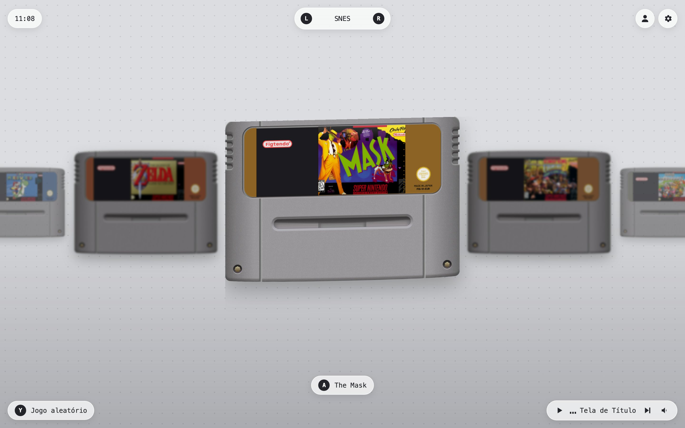
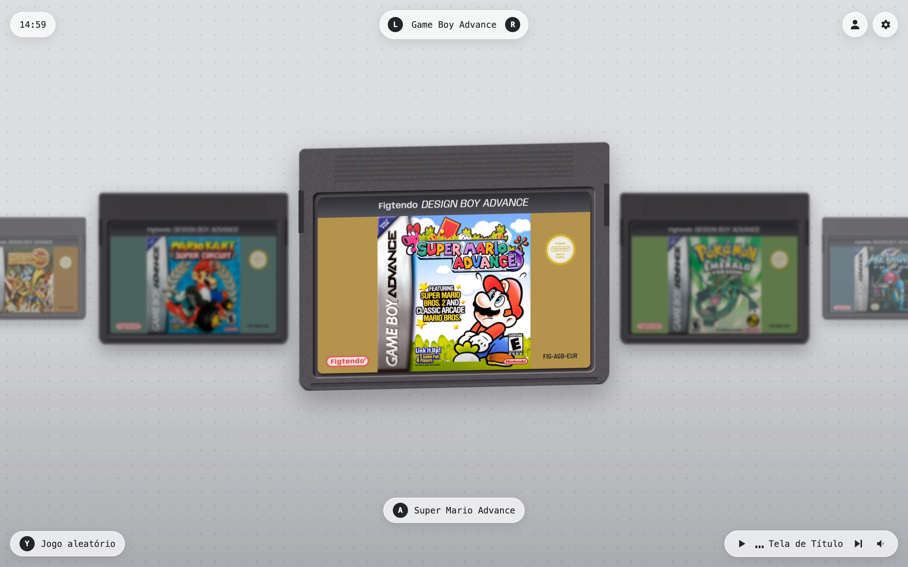
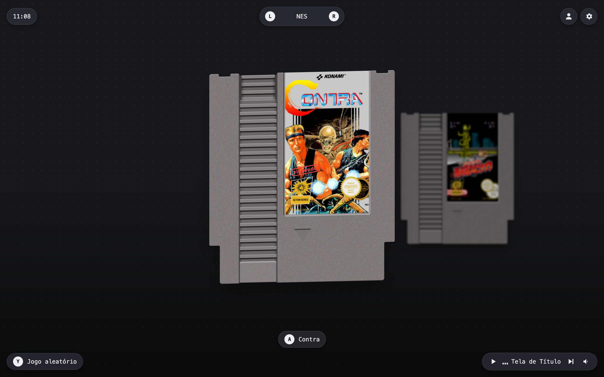
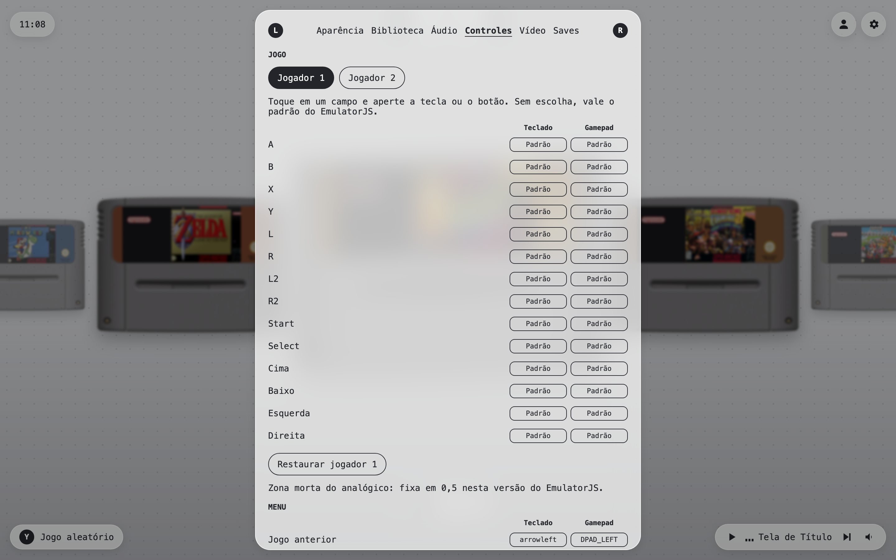
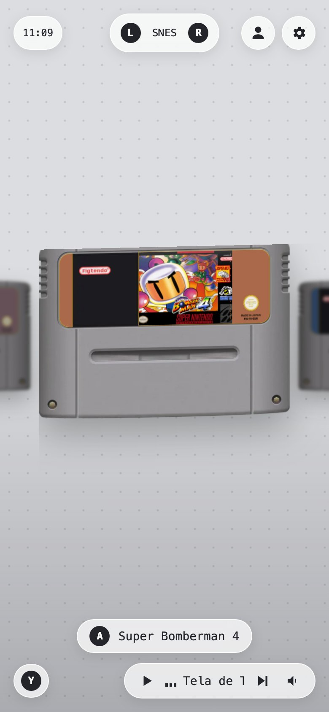
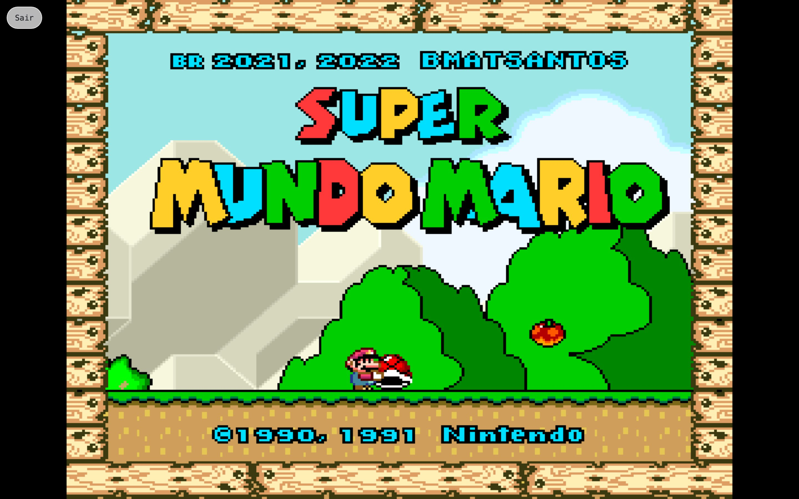

<p align="center">
  
</p>

<h1 align="center">ArcadeLink</h1>

<p align="center"><b>Play your retro games in the browser, straight from your Google Drive.</b></p>

<p align="center">
  
  
  
  
  <a href="https://arcadelink.vercel.app"></a>
  <a href="LICENSE"></a>
</p>

<p align="center">
  <a href="#features">Features</a> &bull;
  <a href="#consoles">Consoles</a> &bull;
  <a href="#usage">Usage</a> &bull;
  <a href="#setup">Setup</a> &bull;
  <a href="#how-it-works">How it works</a> &bull;
  <a href="#limitations">Limitations</a>
</p>

<p align="center">English &bull; <a href="README.pt-BR.md">Português</a></p>

ArcadeLink is a personal retro gaming site. Sign in with Google, drop your ROMs into a folder in your Drive, and pick a game from a carousel of cartridges. Games run in the browser with [EmulatorJS](https://emulatorjs.org), and your saves sync back to the same Drive, so you can stop on one device and continue on another.



> [!NOTE]
> ArcadeLink does not host or distribute any ROM. Games stay in your own Google Drive. It is an independent project, not affiliated with Nintendo, Sega, Sony or any console maker.

## Features

- **Your Drive is the library:** ROMs live in `ArcadeLink/Roms/<console>`, the same layout RetroArch uses. The site never stores them on a server.
- **Saves everywhere:** battery saves and save states are written to `ArcadeLink/Saves/<console>` when you pause, exit or switch tabs, and on a timer you choose.
- **Cartridge carousel:** a mockup for every console, with the game cover printed on the label: cartridges, a DS card, a HuCard and a CD case for PlayStation. Arcade uses a plain box that follows the cover.
- **Automatic covers:** box art comes from [libretro-thumbnails](https://github.com/libretro-thumbnails), even for messy file names like `Super Mario World (PT-BR) - [site].sfc`.
- **Keyboard, mouse, touch and gamepad:** the whole home screen and the settings panel work with a controller.
- **Fast reopen:** after the first launch, a game opens in about a second, since the ROM is cached in your browser.
- **Light and dark themes**, a random game button, and a mini player with 8-bit menu music.

<p align="center">
  
  
</p>

## Consoles

Put each ROM in the matching folder inside `ArcadeLink/Roms`. The folders are created for you on the first sign in.

| Console | Folder | Files |
| --- | --- | --- |
| SNES | `SNES` | `.sfc` `.smc` |
| NES | `NES` | `.nes` |
| Nintendo 64 | `N64` | `.z64` `.n64` `.v64` |
| Game Boy and Game Boy Color | `GB` `GBC` | `.gb` `.gbc` |
| Game Boy Advance | `GBA` | `.gba` |
| Mega Drive / Genesis | `MD` | `.md` `.gen` `.smd` `.bin` |
| Master System | `SMS` | `.sms` |
| Game Gear | `GG` | `.gg` |
| Nintendo DS | `NDS` | `.nds` |
| PlayStation | `PSX` | `.chd` `.pbp` `.iso` `.bin` `.cue` |
| PC Engine | `PCE` | `.pce` |
| Arcade | `ARCADE` (FBNeo romsets) or `MAME` (MAME 2003-plus romsets) | `.zip` `.7z` |

`.zip` and `.7z` work in every folder. Shared extensions such as `.bin` only count inside their console folder.

> [!TIP]
> Arcade ROMs use short codes like `kf2k2mp2.zip`. To show a proper title and cover, add the code to [`src/config/rom-titles.ts`](src/config/rom-titles.ts).

## Usage

| Action | Keyboard | Gamepad |
| --- | --- | --- |
| Previous or next game | <kbd>←</kbd> <kbd>→</kbd> | D-pad or left stick |
| Previous or next console | <kbd>Q</kbd> <kbd>E</kbd> | L, R |
| Play | <kbd>Enter</kbd> or click the cartridge | A |
| Random game | <kbd>Y</kbd> | Y |
| Settings | <kbd>X</kbd> or the gear icon | X |
| Close settings | <kbd>Esc</kbd> | B |
| Exit a game and save | **Sair** button | Select + Start |

Sign in and sign out from the avatar in the top right. Every shortcut can be remapped in **Ajustes, Controles**.

The settings panel has six sections: appearance, library, audio, controls, video shaders and saves. Settings are stored in your browser and in `ArcadeLink/settings.json`, so they follow you to other devices.

<p align="center">
  
  
</p>



## Setup

You need Node.js 20 or later, a Google Cloud project and a Supabase project.

### 1. Google Cloud

1. Create a project and enable the **Google Drive API**.
2. Configure the OAuth consent screen with the name `ArcadeLink`, and add the scopes `drive.file` and `drive.readonly`.
3. Create an **OAuth Client ID** of type Web application, with your Supabase callback as the redirect URI: `https://<project-ref>.supabase.co/auth/v1/callback`.

### 2. Supabase

1. In **Authentication, Providers**, enable Google with the client ID and secret from the previous step.
2. In **Authentication, URL Configuration**, add `http://localhost:3000/**` and your production URL to the redirect URLs.
3. Run [`supabase/migrations/20261102120000_google_tokens.sql`](supabase/migrations/20261102120000_google_tokens.sql) in the SQL Editor. It creates the table that keeps the Google refresh token, readable only by the server.

### 3. Run it

```bash
git clone https://github.com/CarlosAllberto/arcadelink.git
cd arcadelink
npm install
cp .env.example .env.local   # fill in the five values
npm run dev
```

| Variable | Where it comes from |
| --- | --- |
| `NEXT_PUBLIC_SUPABASE_URL` | Supabase, Project Settings, API |
| `NEXT_PUBLIC_SUPABASE_PUBLISHABLE_KEY` | Supabase, API keys, publishable key |
| `SUPABASE_SECRET_KEY` | Supabase, API keys, secret key |
| `GOOGLE_CLIENT_ID` | Google Cloud, Credentials (ends with `.apps.googleusercontent.com`) |
| `GOOGLE_CLIENT_SECRET` | Google Cloud, Credentials (starts with `GOCSPX-`) |

To deploy, import the repository on Vercel, add the same variables and redeploy.

> [!IMPORTANT]
> While the Google app is in testing mode, the refresh token expires after 7 days and the site asks you to reconnect. See [`docs/google-oauth.md`](docs/google-oauth.md) to publish the app for long term personal use.

## How it works

```
src/
├── app/            Pages (login, home, player) and API routes
│   └── api/        Google token refresh and cover lookup
├── components/     Carousel, cartridge, top bar, settings, mini player, player
├── config/         Consoles, cartridge mockups, arcade titles
└── lib/
    ├── google/     Drive access, token cache
    ├── library/    ROM scan, name cleanup, cover matching
    ├── emulator/   EmulatorJS bootstrap, save queue, available shaders
    ├── settings/   Settings store and Drive sync
    └── input/      Keyboard and gamepad navigation, key capture
```

- **Auth.** Supabase handles the Google sign in. The Google refresh token is stored in Supabase and never reaches the browser. A server route trades it for short lived access tokens.
- **Drive.** The browser talks to the Drive API directly. `drive.file` lets the app create its folders and saves, and `drive.readonly` lets it read the ROMs you upload yourself.
- **Covers.** `/api/cover/[console]` matches the game title against the libretro index, ignoring articles, accents, punctuation and roman numerals, then streams the image with a 30 day cache. GitHub serves as a fallback when the libretro server is down.
- **Emulator.** EmulatorJS 4.2.3 loads from its CDN. The ROM is downloaded into memory and cached with the Cache API, keyed by its Drive modification time. Exiting reloads the page, which is the only way to free the emulator.
- **Saves.** Uploads go through a queue so two saves never create duplicate files, and exiting waits for every upload before leaving.

Run the checks with `npm test`, `npm run lint` and `npm run build`.

## Limitations

> [!WARNING]
> Some features of the original plan do not exist in EmulatorJS 4.2.3: Dreamcast, Saturn and PSP cores, configurable analog dead zone (fixed at 0.5), integer scaling, aspect ratio and an LCD shader.

- Arcade and Neo Geo games need the exact romset, and some need BIOS files, which the site does not provide yet.
- A few games do not resume from a save state with the `snes9x` core, such as Super Bomberman 4. The site detects the black screen, restarts the game and keeps the battery save.
- Closing the tab without using **Sair** can lose progress since the last automatic save.
- Full screen needs a click or key press: browsers do not accept a gamepad button as a user gesture.
- Cover lookup through GitHub is limited to 60 requests per hour per server IP.
- One Google account at a time. The interface is in Brazilian Portuguese.
