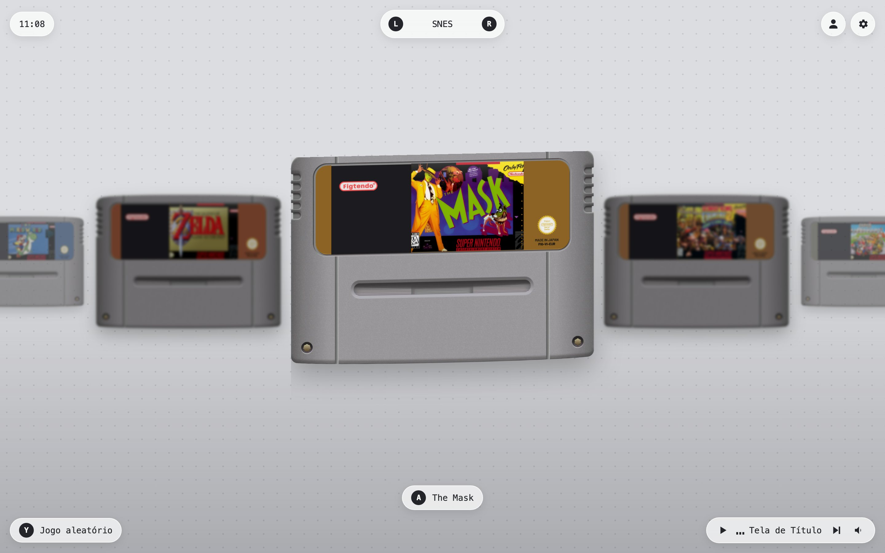
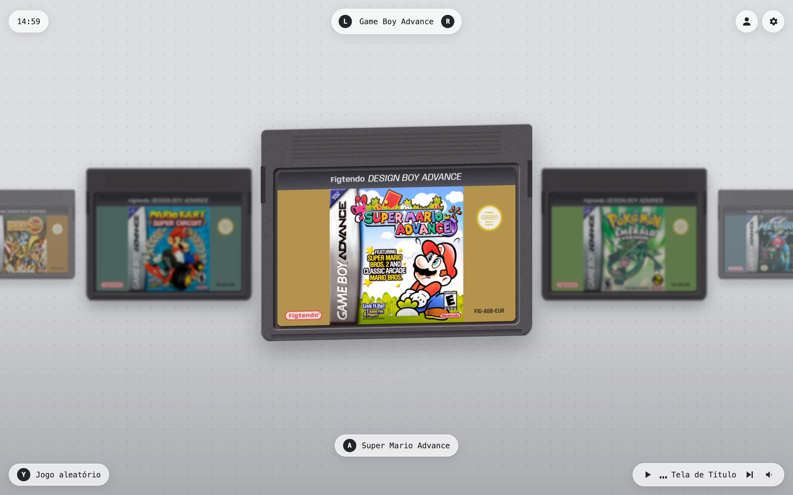
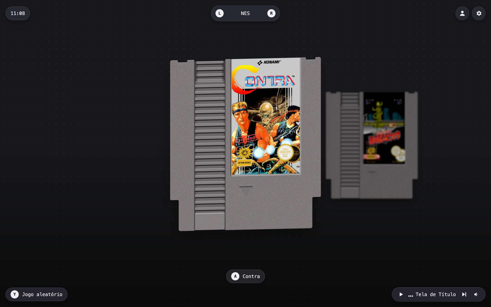
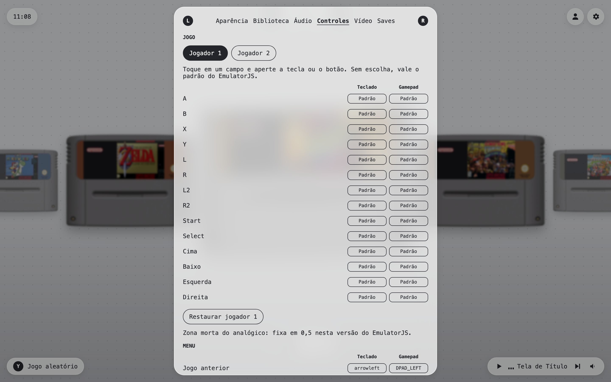
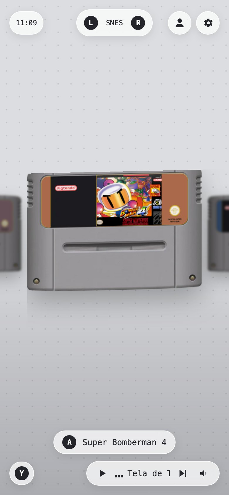
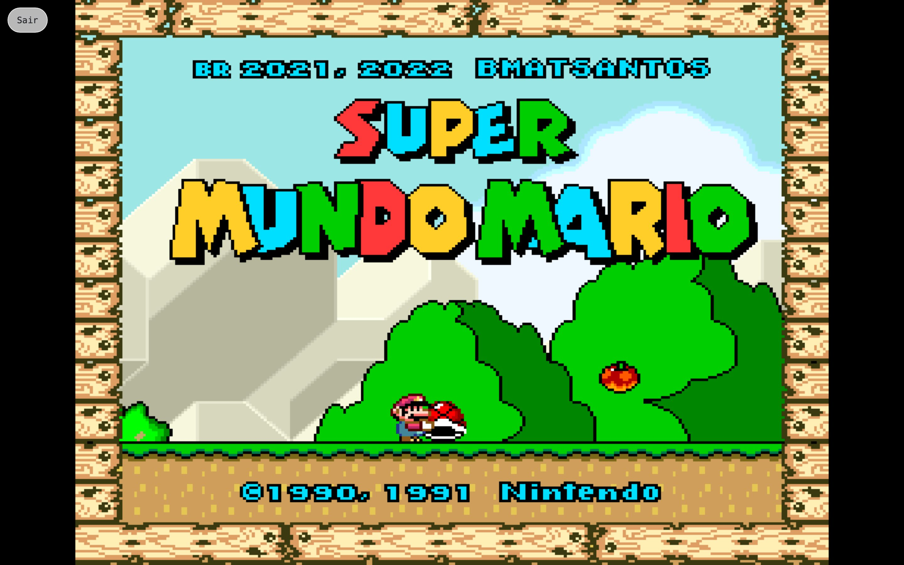

<p align="center">
  
</p>

<h1 align="center">ArcadeLink</h1>

<p align="center"><b>Seus jogos retrô no navegador, direto do seu Google Drive.</b></p>

<p align="center">
  
  
  
  
  <a href="https://arcadelink.vercel.app"></a>
  <a href="LICENSE"></a>
</p>

<p align="center">
  <a href="#recursos">Recursos</a> &bull;
  <a href="#consoles">Consoles</a> &bull;
  <a href="#uso">Uso</a> &bull;
  <a href="#configuração">Configuração</a> &bull;
  <a href="#como-funciona">Como funciona</a> &bull;
  <a href="#limitações">Limitações</a>
</p>

<p align="center"><a href="README.md">English</a> &bull; Português</p>

O ArcadeLink é um site pessoal de jogos retrô. Entre com o Google, coloque suas ROMs numa pasta do Drive e escolha o jogo num carrossel de cartuchos. Os jogos rodam no navegador com o [EmulatorJS](https://emulatorjs.org), e os saves voltam para o mesmo Drive: você para num aparelho e continua em outro.



> [!NOTE]
> O ArcadeLink não hospeda nem distribui ROMs. Os jogos ficam no seu próprio Google Drive. É um projeto independente, sem relação com a Nintendo, a Sega, a Sony ou qualquer fabricante de console.

## Recursos

- **O Drive é a biblioteca:** as ROMs ficam em `ArcadeLink/Roms/<console>`, a mesma estrutura do RetroArch. O site nunca guarda as ROMs em servidor.
- **Saves em qualquer aparelho:** saves de bateria e save states vão para `ArcadeLink/Saves/<console>` ao pausar, sair ou trocar de aba, e no intervalo que você escolher.
- **Carrossel de cartuchos:** um mockup para cada console, com a capa do jogo na etiqueta: cartuchos, cartão de DS, HuCard e caixinha de CD para PlayStation. Arcade usa uma caixa simples que segue a capa.
- **Capas automáticas:** as capas vêm do [libretro-thumbnails](https://github.com/libretro-thumbnails), mesmo com nomes bagunçados como `Super Mario World (PT-BR) - [site].sfc`.
- **Teclado, mouse, toque e gamepad:** a tela inicial e o painel de ajustes inteiros funcionam com controle.
- **Reabre rápido:** depois da primeira vez, o jogo abre em cerca de um segundo, porque a ROM fica no cache do navegador.
- **Temas claro e escuro**, botão de jogo aleatório e miniplayer com músicas 8-bit de menu.

<p align="center">
  
  
</p>

## Consoles

Coloque cada ROM na pasta certa dentro de `ArcadeLink/Roms`. As pastas são criadas no primeiro login.

| Console | Pasta | Arquivos |
| --- | --- | --- |
| SNES | `SNES` | `.sfc` `.smc` |
| NES | `NES` | `.nes` |
| Nintendo 64 | `N64` | `.z64` `.n64` `.v64` |
| Game Boy e Game Boy Color | `GB` `GBC` | `.gb` `.gbc` |
| Game Boy Advance | `GBA` | `.gba` |
| Mega Drive / Genesis | `MD` | `.md` `.gen` `.smd` `.bin` |
| Master System | `SMS` | `.sms` |
| Game Gear | `GG` | `.gg` |
| Nintendo DS | `NDS` | `.nds` |
| PlayStation | `PSX` | `.chd` `.pbp` `.iso` `.bin` `.cue` |
| PC Engine | `PCE` | `.pce` |
| Arcade | `ARCADE` (romsets FBNeo) ou `MAME` (romsets MAME 2003-plus) | `.zip` `.7z` |

`.zip` e `.7z` funcionam em qualquer pasta. Extensões compartilhadas, como `.bin`, só valem dentro da pasta do console.

> [!TIP]
> ROMs de arcade usam códigos como `kf2k2mp2.zip`. Para mostrar o título e a capa certos, inclua o código em [`src/config/rom-titles.ts`](src/config/rom-titles.ts).

## Uso

| Ação | Teclado | Gamepad |
| --- | --- | --- |
| Jogo anterior ou próximo | <kbd>←</kbd> <kbd>→</kbd> | Direcional ou analógico |
| Console anterior ou próximo | <kbd>Q</kbd> <kbd>E</kbd> | L, R |
| Jogar | <kbd>Enter</kbd> ou clique no cartucho | A |
| Jogo aleatório | <kbd>Y</kbd> | Y |
| Ajustes | <kbd>X</kbd> ou a engrenagem | X |
| Fechar ajustes | <kbd>Esc</kbd> | B |
| Sair do jogo salvando | Botão **Sair** | Select + Start |

Entre e saia da conta pelo avatar no canto superior direito. Todos os atalhos podem ser remapeados em **Ajustes, Controles**.

O painel de ajustes tem seis seções: aparência, biblioteca, áudio, controles, vídeo e saves. As configurações ficam no navegador e em `ArcadeLink/settings.json`, então acompanham você em outros aparelhos.

<p align="center">
  
  
</p>



## Configuração

Você precisa do Node.js 20 ou mais novo, de um projeto no Google Cloud e de um projeto no Supabase.

### 1. Google Cloud

1. Crie um projeto e ative a **Google Drive API**.
2. Configure a tela de consentimento com o nome `ArcadeLink` e inclua os escopos `drive.file` e `drive.readonly`.
3. Crie um **OAuth Client ID** do tipo Aplicativo da Web, com o callback do Supabase como URI de redirecionamento: `https://<ref-do-projeto>.supabase.co/auth/v1/callback`.

### 2. Supabase

1. Em **Authentication, Providers**, ative o Google com o ID e o secret do passo anterior.
2. Em **Authentication, URL Configuration**, adicione `http://localhost:3000/**` e a URL de produção às URLs de redirecionamento.
3. Rode [`supabase/migrations/20261102120000_google_tokens.sql`](supabase/migrations/20261102120000_google_tokens.sql) no SQL Editor. Ele cria a tabela que guarda o refresh token do Google, legível só pelo servidor.

### 3. Rodar

```bash
git clone https://github.com/CarlosAllberto/arcadelink.git
cd arcadelink
npm install
cp .env.example .env.local   # preencha os cinco valores
npm run dev
```

| Variável | De onde vem |
| --- | --- |
| `NEXT_PUBLIC_SUPABASE_URL` | Supabase, Project Settings, API |
| `NEXT_PUBLIC_SUPABASE_PUBLISHABLE_KEY` | Supabase, API keys, chave publishable |
| `SUPABASE_SECRET_KEY` | Supabase, API keys, chave secreta |
| `GOOGLE_CLIENT_ID` | Google Cloud, Credenciais (termina em `.apps.googleusercontent.com`) |
| `GOOGLE_CLIENT_SECRET` | Google Cloud, Credenciais (começa com `GOCSPX-`) |

Para publicar, importe o repositório na Vercel, cadastre as mesmas variáveis e publique de novo.

> [!IMPORTANT]
> Enquanto o app do Google estiver em modo de teste, o refresh token expira em 7 dias e o site pede para reconectar. Veja [`docs/google-oauth.md`](docs/google-oauth.md) para publicar o app e usar por tempo indeterminado.

## Como funciona

```
src/
├── app/            Páginas (login, início, player) e rotas de API
│   └── api/        Renovação do token do Google e busca de capas
├── components/     Carrossel, cartucho, barra superior, ajustes, miniplayer, player
├── config/         Consoles, mockups de cartucho, títulos de arcade
└── lib/
    ├── google/     Acesso ao Drive, cache do token
    ├── library/    Leitura das ROMs, limpeza de nomes, busca de capas
    ├── emulator/   Inicialização do EmulatorJS, fila de saves, shaders disponíveis
    ├── settings/   Configurações e sincronização com o Drive
    └── input/      Navegação por teclado e gamepad, captura de teclas
```

- **Login.** O Supabase cuida da entrada com o Google. O refresh token do Google fica no Supabase e nunca chega ao navegador; uma rota no servidor troca esse token por access tokens de curta duração.
- **Drive.** O navegador fala direto com a API do Drive. O `drive.file` permite criar as pastas e os saves do app, e o `drive.readonly` permite ler as ROMs que você mesmo envia.
- **Capas.** A rota `/api/cover/[console]` compara o título do jogo com o índice da libretro, ignorando artigo, acento, pontuação e numeral romano, e entrega a imagem com cache de 30 dias. O GitHub serve de reserva quando o servidor da libretro cai.
- **Emulador.** O EmulatorJS 4.2.3 carrega do CDN dele. A ROM é baixada para a memória e guardada com a Cache API, pela data de modificação no Drive. Sair do jogo recarrega a página, que é o único jeito de liberar o emulador.
- **Saves.** Os envios passam por uma fila, para dois saves nunca criarem arquivos duplicados, e a saída espera todos os envios terminarem.

Rode as verificações com `npm test`, `npm run lint` e `npm run build`.

## Limitações

> [!WARNING]
> Algumas partes do plano original não existem no EmulatorJS 4.2.3: cores de Dreamcast, Saturn e PSP, zona morta configurável do analógico (fixa em 0,5), escala inteira, proporção de tela e shader de LCD.

- Jogos de arcade e Neo Geo precisam do romset exato, e alguns exigem arquivos de BIOS, que o site ainda não envia ao emulador.
- Alguns jogos não retomam do save state no core `snes9x`, como Super Bomberman 4. O site detecta a tela preta, reinicia o jogo e mantém o save de bateria.
- Fechar a aba sem usar **Sair** pode perder o progresso desde o último save automático.
- A tela cheia precisa de um clique ou tecla: o navegador não aceita botão de gamepad como gesto do usuário.
- A busca de capas pelo GitHub é limitada a 60 consultas por hora por IP do servidor.
- Uma conta do Google por vez. A interface é em português do Brasil.
